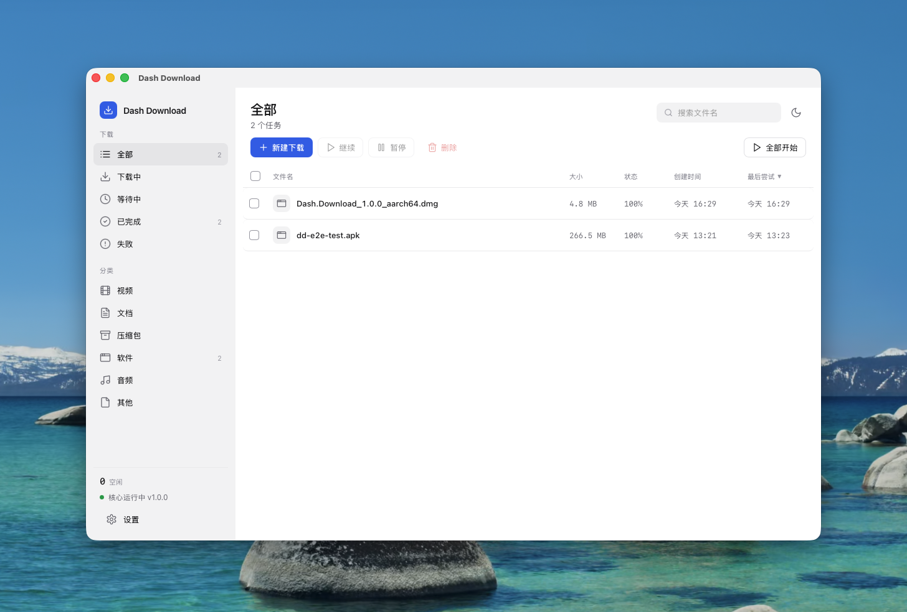

# Dash Download

English | [中文说明](#dash-download-zh)

> Cross-platform desktop downloader and Chrome extension for web video sniffing, stream muxing, and accelerated transfers.

---

## Why Dash Download?

Traditional browser downloads are single-threaded, and modern web videos often split audio and video tracks or use expiring streaming keys.

Dash Download addresses this with a separated architecture:
- **Chrome Extension**: Sniffs web videos on the page, capturing required cookies and headers without manual URL extraction.
- **Desktop App**: Manages multi-threaded downloads, stitches HLS/DASH streams, and muxes high-resolution video and audio tracks into a clean MP4 file. It also supports regular files, BitTorrent magnets, and `.torrent` files.

---

## Quick Start (2 Steps)

### Step 1: Install Desktop App (dd)

Download the installer for your OS from [GitHub Releases](https://github.com/rayz2099/dash-download/releases/latest):

| OS | File Pattern | Installation |
|---|---|---|
| **macOS (Apple Silicon)** | `DashDownload-*-mac-arm64.dmg` | Open `.dmg` and drag `Dash Download.app` to Applications |
| **Windows (x64)** | `DashDownload-*-win-x64.exe` | Run the setup `.exe` |
| **Linux (x64)** | `DashDownload-*-linux-x64.deb` | Install via system package manager or `sudo dpkg -i` |

> **Important**: Launch the app at least once after installing. This registers the native communication bridge with Chrome.

### Step 2: Install Chrome Extension

1. Download `DashDownload-*-chrome.zip` from [GitHub Releases](https://github.com/rayz2099/dash-download/releases/latest) and unzip it.
2. In Chrome, open `chrome://extensions`.
3. Toggle on **Developer mode** in the top-right corner.
4. Click **Load unpacked** in the top-left corner and select the unzipped directory (the folder containing `manifest.json`).
5. Click the extensions icon in Chrome's toolbar and pin **Dash Download**.
6. When opened, the extension popup displays a **green indicator**, confirming it is connected to the desktop app.

---

## Supported Websites & How to Use

### 1. Download Web Videos (One-Click)

Play a video on any webpage. A floating Dash Download button will appear in the bottom-right corner. Click it to choose your desired resolution and start downloading.

- 📕 **Xiaohongshu (小红书)**: Detects note videos and exports original MP4s with playback authentication.
- 🐦 **X (Twitter)**: Merges multiple resolutions and audio streams into a single MP4.
- 📺 **Bilibili (B站)**: Identifies video pages (including multi-part episodes/分P), muxing separate `.m4s` video and audio tracks into MP4.
- 🌐 **General Web Videos**: Supports unencrypted MP4, WebM, HLS (`.m3u8`), and DASH VOD streams.
- ⏳ **More websites**: Continuously being adapted.

### 2. Take Over Browser Downloads

Clicking downloadable files in Chrome can be automatically handed off to Dash Download for accelerated multi-threaded downloading. You can also right-click any link and choose **Download with Dash Download**.

### 3. Torrent & Direct URL

In the desktop app, click **New Download** to paste HTTP/HTTPS links, magnet links, or import local `.torrent` files.

---

## FAQ & Troubleshooting

| Issue | Resolution |
|---|---|
| Extension says `App is not running` | Launch the desktop app once, then re-open the extension popup. |
| Download fails with 403 or empty file | Initiate the download from the active, logged-in browser tab so valid cookies and referer headers are forwarded. |
| macOS security prompt ("Cannot verify developer") | Open **System Settings → Privacy & Security**, scroll down, and click **Open Anyway**. |
| Orange badge on the extension card | Normal for unpacked extensions loaded in developer mode. |

---

# Dash Download (中文)

[English](#dash-download) | 中文说明

> 跨平台桌面下载器与 Chrome 扩展：支持网页视频嗅探、音视频自动混流与浏览器下载接管。

---

## 为什么需要 App + 插件配合？

很多网站（如 B站、小红书、X 等）的网页视频采用了音画分离或者有时效性的流媒体协议，直接使用浏览器下载通常只能获得无声视频或打不开的分段文件。

Dash Download 采用分工架构：
- **Chrome 插件（负责嗅探）**：在浏览器后台自动捕获当前播放视频的真实媒体流地址、清晰度规格与请求凭据（Cookie/Referer），无需手动抓包。
- **桌面客户端（负责下载与合成）**：负责多线程高速下载、流媒体切片拉取与音画自动混流封装（无损输出 MP4），同时支持常规文件加速与 BitTorrent / 磁力链。

---

## 极简上手指南（两步搞定）

### 第一步：安装 Dash Download 桌面客户端 (dd)

前往 [GitHub Releases](https://github.com/rayz2099/dash-download/releases/latest) 下载对应系统平台的安装包：

| 系统平台 | 下载文件 | 安装方法 |
|---|---|---|
| **macOS (Apple Silicon)** | `DashDownload-*-mac-arm64.dmg` | 双击打开 `.dmg`，把 `Dash Download` 图标拖拽到 Applications（应用程序） |
| **Windows (x64)** | `DashDownload-*-win-x64.exe` | 双击运行安装引导程序 `.exe` |
| **Linux (x64)** | `DashDownload-*-linux-x64.deb` | 使用系统安装器打开或终端执行 `sudo dpkg -i` |

> **提示**：安装完成后，**请先启动运行一次桌面客户端**，以便在系统内注册与 Chrome 插件的原生通信通道。

### 第二步：安装 Chrome 浏览器插件

1. 在 [GitHub Releases](https://github.com/rayz2099/dash-download/releases/latest) 下载 `DashDownload-*-chrome.zip` 并解压。
2. 打开 Chrome 浏览器，在地址栏输入 `chrome://extensions` 并回车。
3. 打开页面右上角「**开发者模式**」开关。
4. 点击左上角「**加载已解压的扩展程序**」，选择解压出来的插件文件夹（包含 `manifest.json` 的目录）。
5. 点击 Chrome 右上角拼图图标，把 **Dash Download** 固定到浏览器工具栏。
6. 点击工具栏的 Dash Download 图标，看到**绿色连接状态**即表示插件与桌面端已成功连接。

---

## 核心功能与适配站点

### 1. 网页视频一键抓取与下载

在浏览器中正常播放视频，网页右下角会自动浮现 Dash Download 悬浮按钮。点击展开即可挑选不同清晰度并一键下载为 MP4：

- 📕 **小红书**：自动嗅探图文与视频笔记，一键抓取原画 MP4，自动携带请求上下文，避免 403 权限失效。
- 🐦 **X (Twitter)**：智能关联归并推文视频的多种画质，免去寻找分段的麻烦，一键导出完整 MP4。
- 📺 **Bilibili (B站)**：专项适配普通视频页面（支持多 P 分集选择），自动将分离的 `.m4s` 高清画质与独立音轨混流合并，无需装额外脚本。
- 🌐 **全网通用网页**：支持大多数采用无 DRM 的 MP4、WebM、HLS (`.m3u8`)、DASH 点播协议的网页视频。
- ⏳ **更多网站**：持续专项适配与更新中...

### 2. 接管日常浏览器下载

浏览网页点击下载大文件时，Dash Download 会自动接管下载请求，享受多线程加速与断点续传。在网页任意链接上单击右键，也可以选择「**使用 Dash Download 下载**」。

### 3. BT / 磁力链 / 普通直链

不想用浏览器插件时，也可以随时打开桌面客户端，点击左上角「**新建下载**」，直接粘贴 HTTP/HTTPS 链接、`magnet:?` 磁力链接或导入本地 `.torrent` 种子文件。

---

## 新手避坑与常见问题

| 常见问题 | 解决方法 |
|---|---|
| 插件弹窗显示「app 未运行」 | 桌面客户端尚未启动。打开一次桌面端软件，再重新点击插件图标即可连上。 |
| 小红书或 B 站下载报 403 或文件为空 | 视频链接有时效性与防盗链校验。请在当前已登录且正在播放的网页标签页中，直接点击右下角悬浮按钮下载，插件会自动附带当前会话凭据。 |
| macOS 提示「无法打开，因为无法验证开发者」 | 进入 Mac「系统设置 → 隐私与安全性」，向下滑动找到拦截提示，点击「仍要打开」即可正常运行。 |
| 扩展卡片显示「未打包的扩展程序」 | 这是 Chrome 开发者模式加载本地插件的标准提示，不影响任何正常功能。 |
| 软件版本更新 | 建议客户端与插件保持版本一致。下载新版客户端覆盖安装；替换插件目录文件后，在 `chrome://extensions` 页面点击该扩展卡片右下角的刷新按钮即可。 |

---

## 进阶说明

- 更多视频解析机制与开发环境搭建，请参阅 [视频下载与开发准备](docs/video-downloads.md)。
- 开源协议：[Apache License 2.0](LICENSE)
